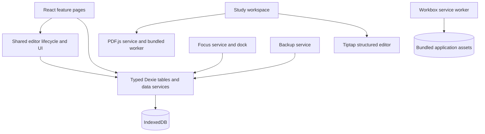

# Study Room architecture

Start with the [agreed architecture plan](PLAN.md) for the product goals, pages, features, boundaries, delivery sequence, and acceptance criteria. This document describes the current implementation; the plan is our baseline when deciding what to build next.

The Flutter iPad companion has its own [architecture document](IPAD_ARCHITECTURE.md) and shares the version-1 backup contract with this web implementation.

## Product and navigation

A local workspace for a BS Psychology student to turn course materials into personally written reviewers and finish explicit study goals. It runs without accounts, AI, a backend, or runtime CDNs.

| Route                 | Responsibility                                                                              |
| --------------------- | ------------------------------------------------------------------------------------------- |
| `/`                   | Public landing page, product workflow, app links, installation instructions, release status |
| `/app/`               | Overview, unfinished goals, recently opened materials, recent reviewers                     |
| `/app/library`        | Courses, local PDF imports, title/topic search, searchable notes, standalone note creation  |
| `/app/courses/:id`    | Course materials, notes, reviewers, goals, and course deletion                              |
| `/app/study/:id`      | PDF rendering, selectable excerpts, page navigation, linked autosaved notes                 |
| `/app/study/note-:id` | Independent notes editor using the same saving behavior                                     |
| `/app/reviewers`      | Search reviewer titles, tags, and written content; create reviewers                         |
| `/app/reviewers/:id`  | Template sections, source references, hidden-answer practice, printable export              |
| `/app/goals`          | Goal completion criteria, linked materials, completion/reopening, session history           |
| `/app/settings`       | Focus defaults, optional alerts, storage/offline status, backup and restore                 |

A persistent focus dock follows the student between pages. Laptop workspaces have an adjustable reading/writing split; phones switch between tabs. The design uses quiet academic colors, clear empty states, and no preloaded fictional student data.

## Modules and boundaries

- Entry point owns routing, navigation, notices, and update readiness. Each page family is a separate feature module.
- The data module owns entity types, schema versions, PDF import validation/deduplication, and deletion semantics. Dexie tables expose typed CRUD/query operations to feature modules.
- The shared draft hook owns serialized autosave, save/error state, Web Lock ownership, navigation protection, retry, and flushing before switching notes or applying updates.
- The workspace renders one PDF page at a time. Text selection copies a quotation and a document/page link into structured note content. Selected note text can be copied to a new reviewer section or an existing field. Selected source links are carried into reviewer references.
- Reviewer templates contain string fields rather than generated HTML. Practice hides answers; print mode reveals all answers and uses the browser's PDF export.
- The focus module owns deadline-based timing, a single active timer, progress reflection, and session persistence. Timer expiration never marks a goal complete.
- Backup takes a consistent database snapshot, packages PDF blobs separately, and validates restore data before a single transaction.

## Data model

All entities use UUIDs. Dexie database `study-room`, version 1, contains:

| Entity       | Key relationships and contents                                                              |
| ------------ | ------------------------------------------------------------------------------------------- |
| Course       | Name, description, color                                                                    |
| Document     | Optional course, tags, PDF blob/hash, page count, resume page, import and last-opened times |
| Note         | Optional course and source document; title, Tiptap JSON, update time                        |
| Reviewer     | Course, tags, ordered typed sections; source references contain document ID, page and quote |
| Goal         | Course, linked document/reviewer IDs, title, completion criterion, status and timestamps    |
| FocusSession | Goal, start/end, actual focus seconds, outcome, reflection                                  |
| ActiveTimer  | Phase, absolute deadline, paused remaining seconds, accumulated focus time, goal            |
| Settings     | Focus/break defaults and sound preference                                                   |

Deleting a PDF preserves notes, reviewer text, and quotations. Reviewer references show an unavailable source when the document is gone; note links still open a workspace explaining the missing document. Deleting a course unfiles its content. Completing a timer leaves its goal unfinished until the student explicitly completes it.

Use a new Dexie version for future schema migrations. Existing legacy localStorage keys are untouched. Inspection of the previous app found only `lastTechnique` persisted; PDF results and flashcards were held in memory, so there is no saved study content to migrate.

## Offline, recovery, and operational limits

- A production build precaches the shell, scripts, styles, icons, PDF worker, fonts, and character maps. The first successful online load is required. Student data is in IndexedDB, not service-worker caches.
- Serve the built application over HTTPS with `vercel.json`: `/` serves the landing page, and `/app/...` falls back to `app.html`. Localhost is supported for development/preview. No server-side API or credentials are required.
- App updates wait for user action, successful editor flushing, and no active session.
- PDFs are limited to 50 MB per file. Duplicate imports open the existing document. Scans remain readable without text selection; OCR is deferred.
- Save failure preserves the current draft and blocks internal page navigation. Before closing a tab with unsaved content, the browser warns when supported. Do not clear browser data as an update mechanism.
- Web Locks prevent concurrent editors from overwriting the same record and designate one timer owner. Close the owning tab and reload another to take over. Modern browsers with Web Locks are recommended.
- Timer deadlines survive reload and background throttling. Expiration records the planned phase once; elapsed unattended time does not fabricate further sessions. Alerts may not fire while the browser is suspended or closed.
- ZIP backup format v1 contains `manifest.json` plus `pdfs/<id>.pdf`. It includes completed history and settings, but excludes the live timer. Restore validates types, IDs, PDF headers, and archive limits before writing. It requires all database tables to be empty. Limits: 250 MB archive, 512 MB expanded, 50 MB per entry. Export large libraries in a browser with sufficient available memory.
- Browser storage can be evicted or cleared. Persistent storage requests reduce eviction risk; external backups are still necessary. No cloud copy exists.

## Verification

Unit tests cover deletion integrity, course unfiling, transactional backup round-trips, malformed restore inputs, searchable structured text, and deadline arithmetic. Production Playwright tests exercise offline PDF reading and notes, reviewer practice, cited excerpt transfer, timer recovery/expiration, cross-tab editor locks, quota failures, and mobile layout.

Run `npm test`, `npm run build`, then `npm run test:e2e`. Development mode does not install a service worker; verify offline behavior against the production preview.

## Public site and hosting

The static landing page (`index.html`, `src/landing.css`) explains the workflow, provides links to the workspace, and gives browser/PWA installation instructions. It does not read the student database. The React entry point is `app.html`, with router basename `/app`. Old workspace URLs normalize into the new path, including `/study/:id` links in existing backup files. The PWA starts at `/app/`; its root service worker also handles legacy source links offline. See [deployment and download status](DEPLOYMENT.md).

Native download links must point to a verified signed release (TestFlight or App Store). Until one exists, the landing page labels the Flutter iPad companion as in development and links to the available web app. Vercel hosts static assets only; importing a PDF still stores it locally in IndexedDB.

## Removing student materials

Library and course note rows expose a labeled **Delete note** action. PDF cards and the open reading workspace expose **Delete PDF**. In the study workspace, both active-note and PDF delete controls live in a sticky header that stays visible during page and editor scrolling. The note action is portaled from its editor so it keeps the existing save and deletion lifecycle. The same accessible native dialog names the selected item, explains what remains, focuses Cancel first, and supports Escape. Failed deletion leaves the dialog open with an error and retry available. These controls work offline.

Deleting a PDF removes its local blob while preserving its notes, reviewers, and quotations. Deleting an open linked note keeps the PDF open and selects the next note; deleting a standalone note returns to Library. Library note deletion acquires the same Web Lock as the editor, preventing deletion while another tab owns that note. Editor deletion serializes with in-flight saves, stops queued autosaves, and clears the pending draft only after deletion succeeds. Autosave updates existing records instead of inserting missing records, so a late write cannot recreate a deleted note.

The landing footer, shared web-workspace footer, and native iPad Settings include the dedication “Dedicated to Ivory Frias, the developer’s beloved.” This is interface text, outside student documents, printing, and backup data.

## Desktop storage discussion — proposed next step

A desktop PWA can be installed with the existing browser controls, but still stores PDFs and notes in browser-managed IndexedDB. Installation alone does not protect against clearing site data or browser eviction. Keep storage persistence requests and ZIP backups available.

For a future desktop package, the proposed direction is Tauri with SQLite metadata and PDF files in the app's local data directory. Reuse the React interface after introducing a storage adapter; simply wrapping the current IndexedDB app would not achieve the intended storage change. Preserve the version-1 ZIP contract for transfer with web and iPad. Desktop packaging, installers, signing, migrations, and physical-device validation are not implemented in this change. Deleting the app's data or losing the device would still require an external backup.
