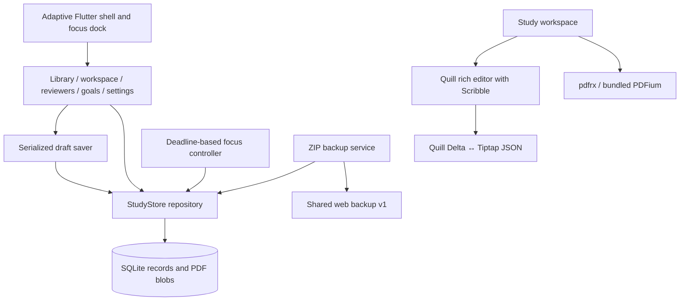

# iPad architecture — Flutter companion

Approved extension to the [agreed plan](PLAN.md), October 20, 2026. The primary student and success criterion stay the same: a BS Psychology student creating notes/reviewers and completing an explicit study goal. The user selected **typed notes with Apple Pencil Scribble first**; a drawing canvas is outside v1.

## Product and visual direction

The iPad app lives in `mobile/` alongside the existing web app. It is a separate native application, not a web view or a replacement of the React project. It uses the same course/material/note/reviewer/goal relationships and backup format.

The supplied [Dribbble study-app collection](https://dribbble.com/tags/study-app-ui) informed card organization, spacing, and study-oriented navigation. The implementation uses original interface components and a locally drawn book illustration; no designer’s screenshots or commercial assets are packaged. Sage, warm paper, pastel document covers, and restrained typography extend the web app’s calm academic direction.

| Area              | Native responsibilities                                                                                             |
| ----------------- | ------------------------------------------------------------------------------------------------------------------- |
| Overview          | Unfinished goals, recently opened readings, recent reviewers, navigation into the next study action                 |
| Library / courses | Files PDF imports, course filters and descriptions, metadata editing, document deletion, searchable notes           |
| Study workspace   | Local PDFium viewer with selection and zoom; rich notes beside the PDF or in an alternate tab; page-linked excerpts |
| Reviewers         | Course/content search, manual templates, editable fields, hidden-answer practice, cited sources, printable PDF      |
| Goals & history   | Explicit completion criteria, linked materials, completion/reopening, focus-session reflections                     |
| Settings & data   | Focus/break preferences, foreground sound preference, offline guidance, ZIP export/restore using Files/share sheet  |
| Focus dock        | Always present across pages and editors; pause/resume, deadline recovery, manual phase transitions                  |

Layout responds to **available window width**, not device-model names: full sidebar at 1150+ logical pixels, compact rail at 700–1149, and bottom navigation below 700. The study surface splits at 850 logical pixels of available content width; narrower views use tabs. iPad orientation is unrestricted, full-screen mode is not required, and only one app scene is enabled. Short windows and keyboard-constrained layouts condense the navigation rail and allow it to scroll.

## Modules and storage

- Flutter’s notifier/listenable model keeps UI, persisted state, and the focus dock in sync. Navigation flushes registered draft savers and stops if saving fails. The live PDF and editor panels retain their widget identity across rotation and layout changes, preserving drafts and editing state.
- `StudyStore` owns SQLite schema version 1. `records(kind, id, json)` stores entities and settings; `pdfs(id, bytes)` stores original PDFs. Import, deletion, session completion, and restore use transactions.
- The same UUIDs and JSON record fields as the web app are used for courses, documents, notes, reviewers, goals, sessions, and settings. Native timer state is internal and excluded from transfer archives.
- Notes use Tiptap JSON as their exchange representation. The editor codec maps the web app’s headings, paragraphs, lists, quotations, emphasis, and links to/from Quill Delta. Opening a note does not rewrite its stored content; editing converts the supported text structure.
- `DraftSaver` debounces writes, serializes pending saves, preserves the live draft on errors, and exposes retry. Backgrounding requests a flush; abrupt process termination can still interrupt the latest uncommitted edits.
- `FocusController` persists absolute deadlines, accumulated focus seconds, paused remaining duration, and the linked goal. It reconciles after foregrounding and expiry without inventing additional sessions. Expiry does not complete a goal.
- Sources retain document ID and page. Excerpts are quotations with source links; copying into a reviewer makes an independent section/field copy, carrying selected references.
- PDF export and UI typography use a locally bundled Noto Sans font under its included open font license. No runtime font request is needed.

## Backup contract and recovery

The archive is the existing web format: `manifest.json` with `version: 1` and collections `courses`, `documents`, `notes`, `reviewers`, `goals`, `sessions`, `settings`, plus `pdfs/<document-id>.pdf`. PDF blobs are separate from document metadata. Unsupported versions, malformed records, invalid PDFs, and archive limits are checked before restoring. The destination must be empty, and restoring commits in one database transaction.

Limits match the web application: 50 MB per PDF/entry, 250 MB ZIP, and 512 MB expanded content. Active timers are not transferred. There is no automatic sync, account, merge behavior, or server.

A web-produced v1 fixture and a native-exported v1 fixture exercise compatibility, including page-linked rich text, reviewer references, goals, and PDF bytes. The archive/schema version must change deliberately if the two clients diverge in future work.

## Validation and release boundary

Dart tests cover SQLite transactions, preservation after deletion, editor-codec references, backup exchange, focus pause/expiry recovery, and explicit completion. Flutter widget tests cover landscape, portrait, and narrow iPad navigation. Native build verification belongs on macOS; the repository includes a workflow that runs analysis, tests, and an unsigned iOS simulator build.

Linux validation is not an iOS simulator run. Actual iPad verification is required for Files permissions/share-sheet anchoring, native PDF rendering and touch selection, Scribble, print dialogs, keyboard interactions, rotation/Split View, and airplane-mode sessions. Foreground completion sounds are supported; background notifications are not implemented in v1. Release signing and App Store publishing are separate future work.
