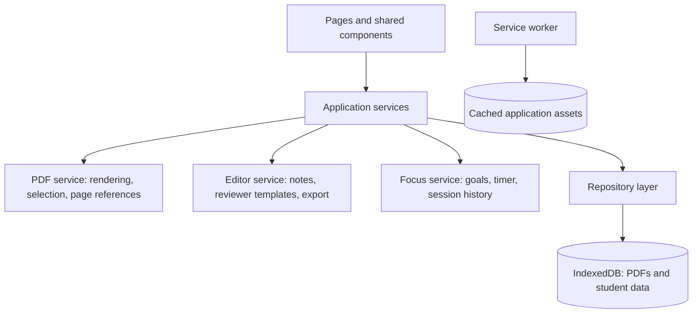

# Offline Psychology Study Workspace — Agreed Architecture Plan

Agreed on October 20, 2026. This is the project’s product and architecture baseline. Read this before changing scope or starting another feature. The [implementation architecture](ARCHITECTURE.md) describes the current system and its operational details.

Keep this baseline intact unless we explicitly agree to revise it. Record an agreed change with its date and reason so future work stays connected to the original goals.

## Summary

Build a laptop-first, installable web app for a BS Psychology student to organize PDFs, write notes, create reviewers, and complete clearly defined study goals.

The main workflow is:

**Choose material → define a goal → read and write → complete a focus session → save progress.**

Use a calm academic design. All core features work offline after the first successful load. No AI, accounts, or cloud services are required.

## Pages and features

| Page                           | Purpose                                    | Main features                                                                                       |
| ------------------------------ | ------------------------------------------ | --------------------------------------------------------------------------------------------------- |
| **Home**                       | Help the student decide what to study next | Continue last workspace, unfinished goals, recent reviewers, create a study goal                    |
| **Library**                    | Organize source materials                  | Import PDFs, assign courses and topics, search titles and tags, rename, delete, reopen at last page |
| **Course**                     | Bring a subject’s materials together       | Course description, topic tags, linked PDFs, notes, reviewers, and goals                            |
| **Study Workspace**            | Read and take notes together               | PDF reader, editable notes, page references, text excerpts, persistent focus timer                  |
| **Reviewers**                  | Find and revise study resources            | Search, course/topic filters, create reviewer, open editor or practice view                         |
| **Reviewer Editor / Practice** | Turn understanding into revision material  | Structured templates, editable sections, source links, hideable answers, printable export           |
| **Goals & History**            | Track meaningful progress                  | Create goals, mark complete, reopen goals, view associated focus sessions and completion notes      |
| **Settings & Data**            | Control preferences and protect saved work | Timer defaults, sound preferences, storage usage, offline readiness, backup and restore             |

These are routes within one application. Main navigation contains Home, Library, Reviewers, Goals, and Settings; courses and workspaces open from relevant items.

### Study workspace

- On laptops, show the PDF and notes side by side with an adjustable divider.
- On phones, switch between PDF and notes using tabs.
- PDF controls include page navigation, zoom, text selection, and resume position.
- “Add excerpt” copies selected text into a note with the document title and page number.
- Excerpts remain visually distinct from the student’s own writing.
- Notes support headings, lists, emphasis, and source references, with visible saving/saved/error states.
- Notes can exist without a PDF. Multiple notes can reference the same document.
- Reference links reopen the source PDF at the cited page.
- An “Add to reviewer” action copies selected note content into a chosen reviewer section. Later edits remain independent.

### Reviewer creation

Students choose a blank reviewer or a psychology-oriented template:

| Template               | Structure                                                   |
| ---------------------- | ----------------------------------------------------------- |
| **Key concepts**       | Term, explanation, example                                  |
| **Theory comparison**  | Theory, main ideas, similarities, differences, applications |
| **Research summary**   | Research question, method, findings, limitations            |
| **Practice questions** | Question, answer, optional source reference                 |

A reviewer can contain multiple section types and draw from multiple documents in the same course. Practice mode hides answers until revealed. Export uses a print layout with browser “Save as PDF.”

Dedicated flashcard decks, spaced repetition, OCR, collaboration, and cloud sync are outside the first version.

### Goals and focus timer

- Each goal has a title, course, optional linked materials, and an explicit completion criterion.
- Example: “Compare the multi-store and working-memory models; finish the comparison reviewer.”
- A goal can span several focus sessions.
- The timer offers a circular progress display, start, pause, resume, end, and adjustable focus/break durations.
- Default durations are 25 minutes of focus and 5 minutes of break. Transitions require a user action.
- A compact timer stays visible throughout the app.
- Ending a session asks whether the goal is complete or needs more work, with an optional progress note. Timer expiration never automatically completes the goal.
- Persist timer state and calculate remaining time from timestamps so tab switching and reloads do not reset it.
- Reopening after an elapsed deadline records the elapsed phase and asks what to do next; it does not invent additional completed sessions.
- Sounds and browser notifications are optional. Background notification delivery depends on browser support; saved timer state remains reliable.
- Only one active timer is allowed across tabs.

## System architecture

Use **React, TypeScript, and Vite** for the application, **React Router** for navigation, **PDF.js** for reading and text selection, **Tiptap** for structured editing, and **Dexie/IndexedDB** for local storage. Use a service worker through a Vite PWA integration for offline application assets.

Bundle scripts, fonts, icons, and the PDF worker locally. Remove runtime CDN dependencies and the existing Supabase/Gemini integration.

### Responsibilities and interfaces

- **Presentation:** pages and reusable components display state and handle interactions; they do not access IndexedDB directly.
- **Application services:** coordinate PDF import, autosave, reviewer creation, goal completion, and backup/restore.
- **Repository layer:** typed CRUD and queries, transactions, and versioned database migrations.
- **PDF service:** renders pages on demand, extracts selectable text, and creates document/page references without uploading files.
- **Focus service:** owns the persisted timer state and cross-tab ownership.
- **Offline layer:** caches the application shell; PDFs and student content remain in IndexedDB, separate from asset caches.

Organize code by feature—library, workspace, reviewers, focus, and settings—with shared storage and UI modules. Keep the architecture description and entity relationships in repository documentation before implementation begins.

### Core data model

| Entity           | Stores and relates                                                                    |
| ---------------- | ------------------------------------------------------------------------------------- |
| **Course**       | Name, description, display color                                                      |
| **Document**     | PDF blob, title, course, topic tags, page count, last page, import time, content hash |
| **Note**         | Title, course, optional primary document, structured editor content, timestamps       |
| **Reviewer**     | Title, course, topic tags, ordered structured sections, source references, timestamps |
| **Goal**         | Title, completion criterion, course, linked material IDs, status, completion time     |
| **FocusSession** | Goal, start/end times, actual focus duration, outcome, progress note                  |
| **ActiveTimer**  | Phase, running/paused state, deadline or remaining duration, linked goal/session      |
| **Settings**     | Timer defaults, sound/notification preferences, data format version                   |

Use stable UUIDs. Source references contain document ID, page number, and quoted text where applicable. Search covers titles, tags, and written note/reviewer text; full-PDF indexing is deferred.

### Persistence and failure handling

- Save PDF imports transactionally; show success only after local persistence succeeds.
- Accept PDFs up to 50 MB in v1. Detect duplicates by content hash and offer to open the existing document.
- Scanned PDFs remain readable, but show that selectable text is unavailable; students can write notes manually.
- Clearly report corrupt, encrypted/unsupported, and storage-full imports without leaving partial library entries.
- Autosave edits after a short debounce and on editor blur. Keep unsaved edits visible if saving fails.
- Warn on concurrent editing of the same note or reviewer in another tab to prevent silent overwrites.
- Deleting a PDF preserves notes and reviewers, retaining quotation text while marking source links unavailable.
- Deleting a course moves its content to “Unfiled.”
- Request persistent browser storage when supported. Explain that browser data removal can erase local work.
- Provide a versioned ZIP backup containing PDFs and structured data. Restore validates the archive before writing and imports only into an empty library in v1.
- Activate application updates after editors have saved and no focus timer is running.

## Delivery sequence and validation

1. **Foundation:** document architecture; establish application routes, local database, migrations, shared design, and bundled assets.
2. **Library and reading:** implement courses, PDF import, reader, search, and resume position.
3. **Notes and reviewers:** implement autosave, excerpts, templates, practice mode, and print export.
4. **Goals and focus:** connect explicit goals to persistent focus sessions and history.
5. **Offline and resilience:** finish installability, offline readiness, backup/restore, update handling, and failure recovery.

Validate each stage with focused service tests and browser workflows:

- Import a PDF, create notes and a reviewer, reload, and verify saved content and page references.
- Load the app once, disconnect the network, then reopen it, import a local PDF, edit, practice, and run the timer.
- Check scanned, duplicate, corrupt, oversized PDFs, and simulated storage failures.
- Verify autosave recovery, source deletion, course deletion, and backup/restore.
- Verify timer pause/resume, reload, background-tab delays, expired deadlines, and competing tabs.
- Confirm a completed timer leaves its goal unfinished until the student explicitly marks it complete.
- Check keyboard navigation, editor accessibility, and laptop/mobile layouts.
- Run a production build and confirm no core workflow requests CDN, AI, or Supabase resources.

Keep existing local data intact during migration. Inspect the current storage keys during implementation and migrate only recognized saved content; remove the obsolete AI upload path and update the README to describe actual behavior.

## Defaults

- One student, one browser profile, no login or cross-device sync.
- Laptop-first layout with functional mobile views.
- Manual, guided reviewer creation; no automatic summaries.
- Offline availability begins after the application has loaded and cached successfully.
- Static HTTPS hosting; browser storage holds all student materials.
- Success means completing a clearly defined study goal, with focus time as supporting information.

## Agreed extension — October 20, 2026: iPad companion

Add a separate Flutter application in `mobile/`, designed for iPad. Preserve the existing web app and the core offline study workflow. The first native version uses typed rich notes with Apple Pencil Scribble enabled; dedicated handwriting/drawing remains deferred. Use the existing version-1 ZIP format for manual transfer between web and iPad, with no automatic sync or account requirement.

See [the iPad architecture](IPAD_ARCHITECTURE.md) for native pages, responsive tablet layouts, SQLite persistence, editor conversion, test coverage, and the macOS/iPad validation boundary. This extends the delivery platforms; the original student, product goals, and non-AI direction remain the baseline.

## Delivery amendment: landing page and Vercel

Deploy the web workspace and a public landing page together on Vercel. Public `/` explains the product and installation; `/app/` starts the existing study workflow. Preserve version-1 source references and offline behavior. Offer the installable browser app immediately, and add a native iPad download only after a signed, tested release exists. See [DEPLOYMENT.md](DEPLOYMENT.md) for the operational steps.

## Material deletion and dedication

Make deletion discoverable in Library, course notes, and the open PDF/note workspace. Require item-specific confirmation, preserve notes when deleting their PDF, and prevent autosave or another editor tab from recreating a deleted note. Use the same personal dedication in the landing page, web workspace, and native Settings: “Dedicated to Ivory Frias, the developer’s beloved.” Keep it outside student content and exports.

Desktop installation was discussed as a future storage improvement. A proposed Tauri package would reuse the React interface with SQLite and a local PDF directory; installing the current PWA alone does not change its browser-managed storage. This remains a proposed next phase; see the implementation architecture for the boundary.

## Desktop delivery extension

The Windows Tauri companion reuses the agreed pages and features, storing metadata in SQLite and PDFs in the app-data folder. Keep the browser and Flutter implementations and the version-1 ZIP contract. See [desktop architecture](DESKTOP_ARCHITECTURE.md) for implementation, delivery, and recovery details. Windows x64 is the first installer target; other desktop platforms are deferred.
